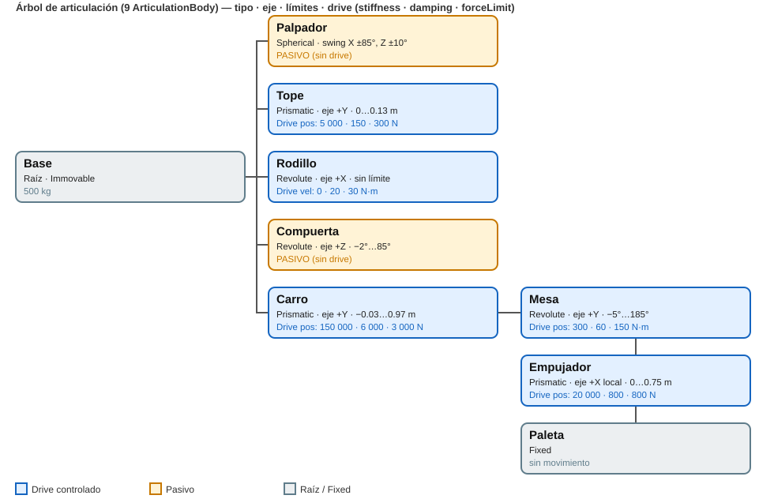
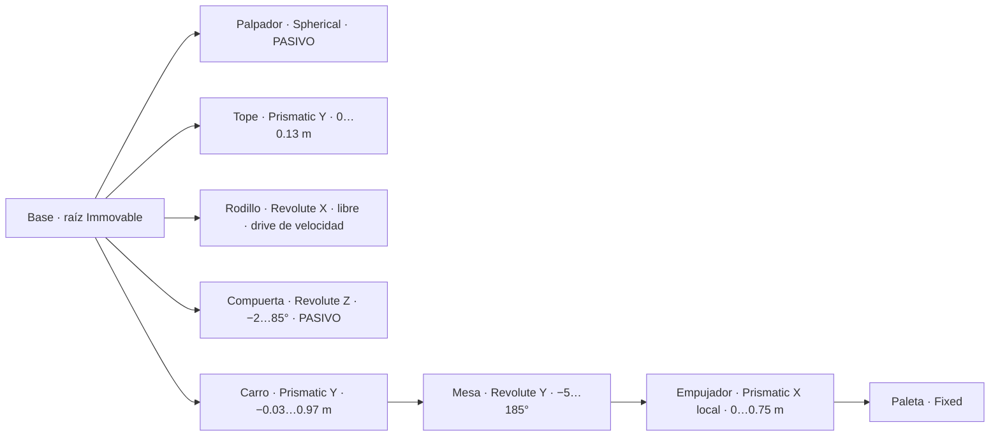

# Estación de Transferencia y Clasificación — documento de entrega

Simulador de Unity (ArticulationBody) · materia Simuladores.

## 1. Qué máquina y qué operación simula

Una **estación de transferencia y clasificación de paquetería** de un centro de distribución. Llegan cajas de cartón de aspecto idéntico pero con distinta **altura** (0.20 m o 0.40 m) y **masa** (4 a 20 kg). El operador mide la altura con un **palpador mecánico pasivo** y la masa con una **balanza integrada en el elevador**. Después eleva, gira y empuja cada caja a uno de **4 destinos** (2 lados × 2 niveles).

Regla de clasificación: altura < 0.30 m → Nivel 1, si no Nivel 2; masa < 10 kg → Izquierda, si no Derecha.

| Tipo de caja | Alto | Masa | Destino |
|---|---|---|---|
| Baja liviana | 0.20 m | 4 kg | Izquierda · Nivel 1 |
| Alta liviana | 0.40 m | 6 kg | Izquierda · Nivel 2 |
| Baja pesada | 0.20 m | 18 kg | Derecha · Nivel 1 |
| Alta pesada | 0.40 m | 20 kg | Derecha · Nivel 2 |

## 2. Árbol de la articulación

Un solo árbol, raíz `Base` (Immovable), **9 ArticulationBody**, **4 tipos de joint** (Fixed, Prismatic, Revolute, Spherical), **5 drives controlados** y **2 partes pasivas** (Palpador y Compuerta). Los límites de cada unión están en el diagrama y en la tabla.

| Cuerpo | Padre | Tipo | Eje | Límites | Drive (stiffness · damping · forceLimit) |
|---|---|---|---|---|---|
| Base | — | raíz Immovable | — | — | — |
| Palpador | Base | Spherical | swing en X (±85°) y Z (±10°); twist bloqueado | ver eje | ninguno (pasivo) |
| Tope | Base | Prismatic | +Y | 0 … 0.13 m | 5 000 N/m · 150 N·s/m · 300 N |
| Rodillo | Base | Revolute | +X | sin límite | velocidad: 0 · 20 · 30 N·m |
| Compuerta | Base | Revolute | +Z | −2° … 85° | ninguno (pasivo) |
| Carro | Base | Prismatic | +Y | −0.03 … 0.97 m | 150 000 N/m · 6 000 N·s/m · 3 000 N |
| Mesa | Carro | Revolute | +Y | −5° … 185° | 300 · 60 · 150 N·m |
| Empujador | Mesa | Prismatic | +X local de la mesa | 0 … 0.75 m | 20 000 N/m · 800 N·s/m · 800 N |
| Paleta | Empujador | Fixed | — | — | — |

Unidades: metros, kilogramos, grados. Ejes en coordenadas de mundo con el mecanismo en reposo (+X derecha, +Y arriba, +Z sentido de avance de las cajas).

## 3. Cómo se controla

- **Drives de posición** (Tope, Carro, Mesa, Empujador): el usuario elige un *preset* (por ejemplo Carga / Nivel 1 / Nivel 2 para el carro) y el simulador mueve el *target* del drive con una **rampa de velocidad** aplicada en `FixedUpdate`, de modo que el target nunca salta. Un fantasma cian muestra el target y la pieza real lo sigue.
- **Drive de velocidad** (Rodillo): marcha 1.8 m/s, reversa −0.5 m/s o paro. Con el paro funciona además como freno.
- **Partes pasivas:** el Palpador (péndulo sobre la rampa) lo levanta la caja que baja por gravedad y mide su altura por la posición de la bola respecto del plano de la rampa. La Compuerta la abre la caja al pasar y la gravedad la cierra.
- **Balanza:** sensor derivado del drive del carro. Con el carro quieto, `driveForce` iguala el peso de lo que cuelga; masa = F/g − tara (41.5 kg).
- **Enclavamientos:** carro y mesa solo se mueven con el empujador retraído; entra una caja por vez.
- **Maniobra:** N (nueva caja) → Espacio (libera) → Espacio (retiene) → R con carro en Carga y mesa a 0° → R (detiene) → leer balanza → elevar y girar según la regla → E (empujar) → Q (retraer) → volver a Carga. Las teclas completas están en el README y en la ayuda del simulador (H).

## 4. Cómo se eligieron los valores de los drives

Criterio general: la **constante elástica** según el error estático admisible bajo la peor carga, el **damping** cerca del crítico (ζ ≈ 1, `d ≈ 2·√(k·m)`) y el **forceLimit** con un margen de unas 3× sobre la fuerza estática máxima. Se ajustó de la raíz a la punta.

- **Carro:** masa suspendida = 25 + 12 + 3 + 1.5 + 20 (caja máx.) = 61.5 kg → ≈ 603 N. Con k = 150 000 N/m el hundimiento estático es ≈ 4 mm. Damping crítico = 2·√(150 000·61.5) ≈ 6 075 → 6 000. forceLimit 3 000 N (≈ 5× el peso). Rampa 0.35 m/s.
- **Mesa:** inercia en Y ≈ 1 + 0.5 + 0.8 ≈ 2.3 kg·m². Con k = 300 N·m/rad, ω ≈ 11 rad/s; d = 2·√(300·2.3) ≈ 52 → 60. Rampa de 45 °/s para que la aceleración tangencial quede muy por debajo de μ·g y la caja no deslice.
- **Empujador:** vence la fricción de la caja más pesada, 0.10·20·9.81 ≈ 20 N, más la inercia. k = 20 000 N/m, d = 800, forceLimit 800 N. Rampa 0.45 m/s.
- **Tope:** resiste la componente de la caja sobre la rampa de 7° (≈ 24 N, lateral). Rigidez moderada; rampa 0.4 m/s.
- **Rodillo:** drive de velocidad pura (stiffness 0). Con damping 20 y marcha en 0 actúa de freno. La tracción alcanza ≈ 0.9·N, sobrada para acelerar la caja a 1.8 m/s.
- **Palpador y Compuerta:** sin stiffness ni target, solo una `jointFriction` de 0.05 para amortiguar la oscilación.

**Validación:** prueba automatizada con las 4 clases de caja llevadas a su destino 6 de 6 veces seguidas, 0 errores y 0 caídas. La balanza leyó 4.0 / 6.0 / 18.0 / 20.0 kg.

Detalle completo (posiciones de reposo, geometría, lecciones de las pruebas): [DESIGN_AND_JOINTS.md](DESIGN_AND_JOINTS.md).

## 5. Enlaces

- Repositorio: https://github.com/Tamara1001/ArticulationBody
- Build en itch.io: <!-- LINK itch.io -->
- Video en YouTube: <!-- LINK YouTube -->
